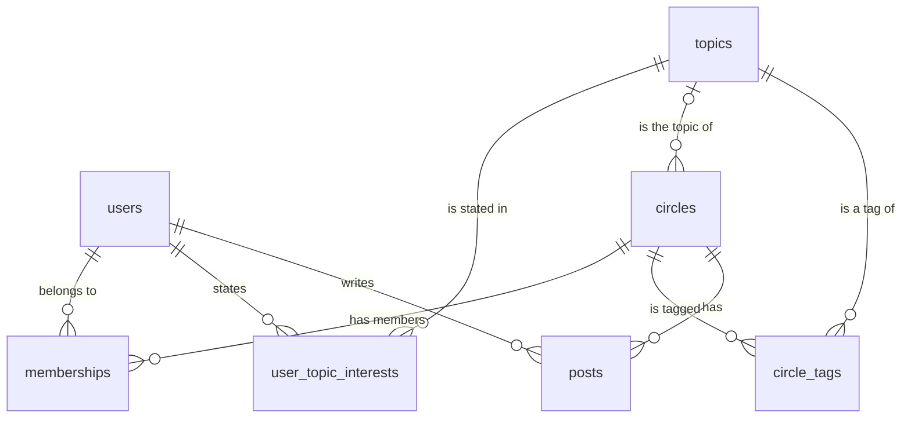

# Database Schema

PostgreSQL 18, managed by Flyway:

- [`V1__init.sql`](../src/main/resources/db/migration/V1__init.sql): tables, constraints, indexes
- [`V2__Seed_data.java`](../src/main/java/db/seed/V2__Seed_data.java): loads the provided JSON (left out by the `prod` profile)

Hibernate runs with `ddl-auto=validate`: it checks that the entities match this schema and never changes it.

## Relationships

| Table | Primary key | Notes |
|---|---|---|
| `topics` | `id` | `slug` is UNIQUE |
| `users` | `id` | profile fields, `joined_at`, `profile_completeness` (CHECK 0–1) |
| `user_topic_interests` | (`user_id`, `topic_id`) | stated interests, many-to-many |
| `circles` | `id` | `topic_id` nullable (2 Circles have no topic). `max_members` nullable (null = no limit). Activity counters |
| `circle_tags` | (`circle_id`, `topic_id`) | tags, many-to-many |
| `memberships` | (`user_id`, `circle_id`) | `role` is `member` or `leader`. A Circle's leaders are members with `role = leader` |
| `posts` | `id` | feed posts with engagement counts |

## Design decisions

- **IDs come from the dataset** (plain `BIGINT`, not generated), so planted records keep their ids (user 42 is always user 42).
- **Topics are referenced by `topics.id`.** Slugs are translated during loading.
- **Join tables, not arrays,** for interests and tags: foreign keys guarantee every topic exists, and both directions can be indexed if ever needed.
- **Composite primary keys** for the link tables: a duplicate membership, interest or tag is impossible.
- **Fixed-choice fields are `VARCHAR` + `CHECK`** (`format`, `access`, `join_policy`, `role`). The database rejects bad values from any source, and changing the allowed list is a one-line migration (unlike Postgres `ENUM`, which can't drop values). In Java they're enums with an `AttributeConverter`, never `@Enumerated(ORDINAL)`.
- **Derived values.** The rule: store a value only if it's expensive to compute and can be kept in sync.
  - *Is it full?* Computed from `max_members` and `member_count`, never stored.
  - `member_count` is stored: it's read for every candidate, and reads vastly outnumber joins and leaves.
  - The activity score is computed per request. At scale it would be precomputed (see the design doc).
- **Foreign keys use the default `ON DELETE`** (block the delete), so no row is ever removed by surprise.

## Indexes

The rule: **add an index only if you can name the query it speeds up.** Primary keys and UNIQUE
constraints are indexed automatically, and they already cover every lookup the API makes today:
the user, their interests (PK prefix `user_id`), and their memberships (PK prefix `user_id`).

| Index | Query it serves |
|---|---|
| `memberships (circle_id)` | "Who is in, or leads, this Circle?" The PK starts with `user_id`, so it can't help, and Postgres doesn't index foreign keys automatically. |
| `topics (slug)` UNIQUE | A data rule (no duplicate slugs). The loader also looks topics up by slug. |
| `circles (topic_id)` | At scale: find candidate Circles by topic instead of loading all of them. |
| `posts (circle_id, created_at)` | At scale: count a Circle's posts in the last 30 days from real events (range scan). |

**Deliberately not indexed:** `user_topic_interests (topic_id)`, `circle_tags (topic_id)`,
`posts (author_user_id)`. No query looks them up that way, and every index slows down writes.

## Data-quality finding

A trial load showed the constraints doing their job: **Circle #17 lists the tag `difficult-conversations` twice**
in `circles.json` (the generator can pick the Circle's own topic a second time). The `circle_tags` primary
key rejects it, so the loader de-duplicates tags. Loaded row counts: topics 22, users 100,
interests 140, circles 40, tags 82, memberships 441, posts 386.
